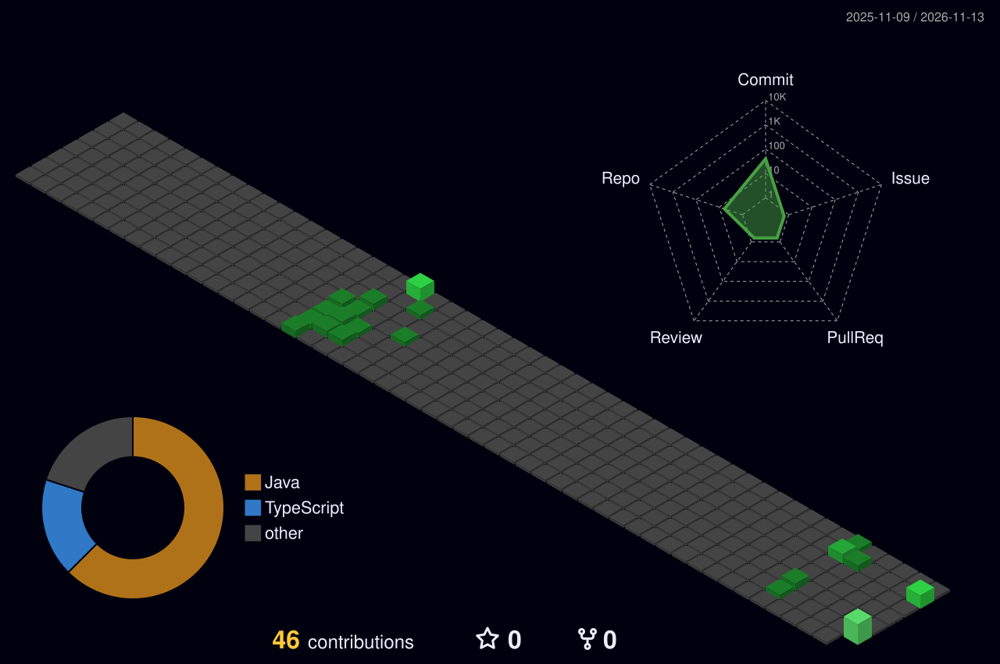

<h1 align="center">Hello 👋, I'm Uday</h1>

<h1 align="center">Language and Tools:</h1>

	<code></code>
	<code></code>
	<code></code>
	<code></code>
	<code></code>
	<code></code>
	<code></code>
	<code></code>
	<code></code>
	<code></code>
	<code></code>
	<code></code>
	<code></code>
	<code></code>
	<code></code>
	<code></code>
	<code></code>

 
Contribution Graph:  
 

 

  

GitHub Stats:
 

  
  

Contribution History:
 

  

Socials:
 

  &nbsp;&nbsp;&nbsp;
  <!-- Put your own link in place of YOUR-ID, then remove this comment's first and last lines:
  &nbsp;&nbsp;&nbsp;
  -->

